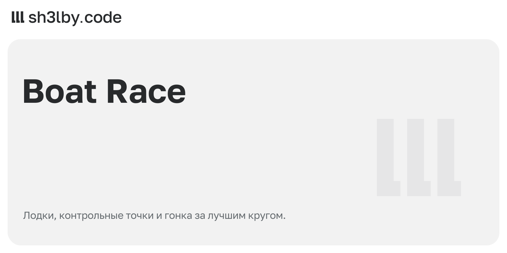

# Race

<!-- portfolio-card:start -->

<!-- portfolio-card:end -->

Гонки на лодках для Paper 1.21: одна трасса в отдельном мире, один активный заезд,
по умолчанию 15 кругов.

## Команды

| Команда | Действие |
|---|---|
| `/race` | Подсказка по командам. |
| `/race leave` | Выйти из заезда и вернуться в точку, откуда забрала гонка. |
| `/race start [круги]` | Забрать всех онлайн на стартовые позиции, посадить в лодки и запустить отсчёт. Без аргумента — `laps` из конфига. Право `race.admin`. |
| `/race stop` | Отменить заезд и вернуть участников. Право `race.admin`. |

## Настройка трассы в игре

Всё под правом `race.admin`, во время заезда трассу менять нельзя. Зоны берутся из
выделения WorldEdit: `//wand`, левый клик по одному углу, правый по другому.

| Команда | Действие |
|---|---|
| `/race setworld` | Мир гонок — тот, где стоишь. Пустое значение подставляется само при первой зоне. |
| `/race addstart` | Добавить стартовую позицию: твои координаты и направление взгляда. |
| `/race setfinish <+X\|-X\|+Y\|-Y\|+Z\|-Z>` | Финиш из выделения + разрешённое направление пересечения. |
| `/race addcp` | Добавить чекпоинт из выделения (номер = порядок добавления). |
| `/race clear <starts\|cp> [last]` | Очистить список; с `last` убрать только последнюю запись. |

Каждая команда сразу пишет `config.yml` и отвечает сохранёнными координатами, перезагрузка
не нужна. Подходит и FastAsyncWorldEdit. Без WorldEdit работают все команды, кроме двух с
зонами, — зоны тогда задаются в конфиге руками.

Записи нет: `/race start` забирает всех, кто онлайн, по порядку раздаёт стартовые позиции и
выдаёт лодки (на 3 блока выше точки, лодка падает на место), запомнив, откуда забрал каждого.
Мёртвых и зрителей пропускает; если игроков больше, чем позиций, лишние остаются вне заезда,
и администратору говорят сколько. Кто не хочет гоняться — `/race leave`. Повторный
`/race start` активный заезд не сбрасывает, заканчивается он сам, когда на трассе никого не
осталось, либо по `/race stop`.

## Трасса

`config.yml` задаёт мир, стартовые позиции, зону финиша с разрешённым направлением
пересечения, пронумерованные чекпоинты, число кругов, отсчёт и предел времени. Зоны — два
угловых блока, они входят в зону целиком. Конфиг читается заново при каждом запуске заезда,
отдельной перезагрузки не нужно. При неполной настройке запуск запрещён, `/race start`
перечисляет причины администратору.

Круг засчитывается только после прохождения всех чекпоинтов по порядку и последующего
пересечения финиша в разрешённом направлении: стартовое пересечение, катание туда-сюда и
стояние в зоне прогресса не дают. Пересечения считаются по отрезку между положениями лодки
в соседних тиках, поэтому узкий чекпоинт не проскакивается на скорости.

## Результаты

В actionbar во время заезда: `Круги: 3/15 | Время: 02:34.56` — время реальное, от общего
старта. Итоги выводятся таблицей (место, ник, время, DNF с причиной) и пишутся в
`plugins/Race/results/<дата>_<время>.yml` вместе с UUID игроков. Одинаковое время — одинаковое место.

Снятие с заезда: выход из лодки (ловится сразу по событию, обратно сесть не получится),
смерть, выход с сервера или из мира гонок, уничтожение лодки, состоявшийся посторонний
телепорт, `/race leave`. Ограничения по времени нет — заезд висит, пока кто-то едет, и
снимается командой `/race stop`. Срезать мимо чекпоинтов бесполезно: без них круг не
засчитывается, поэтому отдельных границ трассы нет.
Вернуть игрока после выхода с сервера плагин пытается при следующем входе
(`plugins/Race/returns.yml`).

## Проверка

`mvn test` — геометрия зон, подсчёт кругов (полный маршрут, катание на финише, пропуск
чекпоинта, обратное направление, узкая зона на скорости), валидация конфига и round-trip:
то, что пишут команды настройки, парсер читает обратно.
Остальное проверяется в игре: телепорт, выход и повторный вход, посадка посторонних, DNF.
